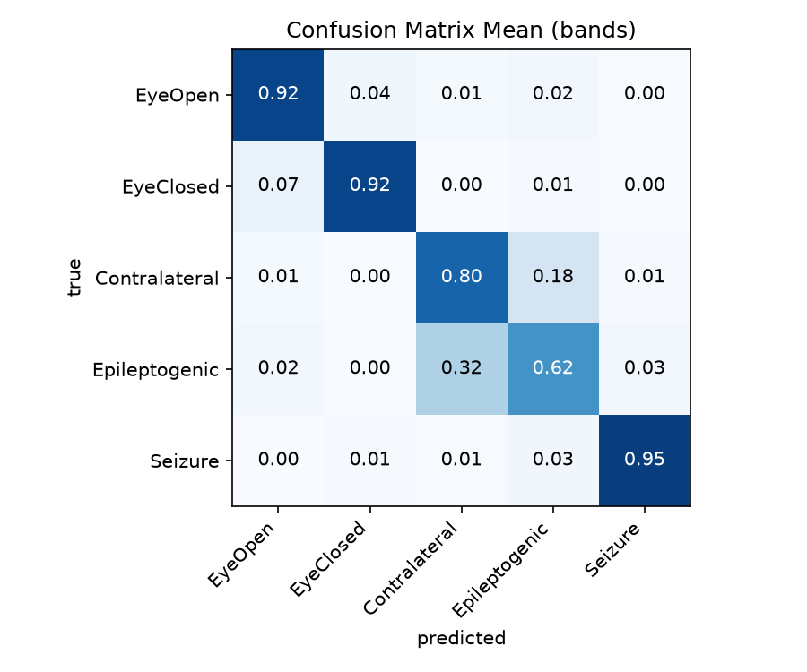
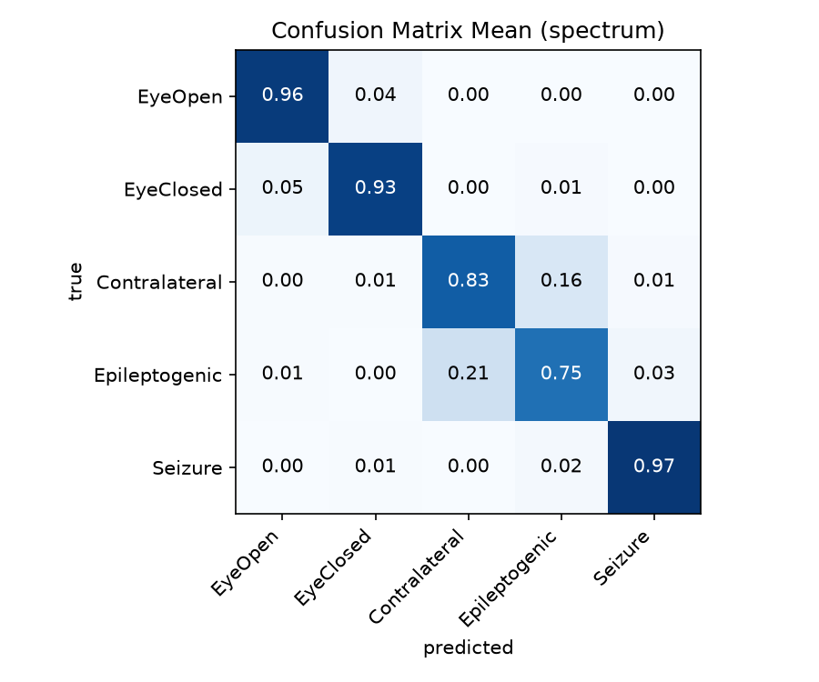

# EEG Confusion Anatomy

This project classifies 5 kinds of neural recordings from the Bonn EEG Epileptic dataset (Andrzejak et al., 2001) to see which classes the models confuse.

| Class | Who | Electrode | Condition |
| --- | --- | --- | --- |
| **EyeOpen** | 5 healthy volunteers | on the scalp | resting, eyes open |
| **EyeClosed** | same 5 healthy | on the scalp | resting, eyes closed |
| **Contralateral** | 5 epilepsy patients | inside the skull | between seizures, from the *non*-epileptogenic side of the brain |
| **Epileptogenic** | same 5 epilepsy patients | inside the skull | between seizures, from the epileptogenic side |
| **Seizure** | same 5 epilepsy patients | inside the skull | during an actual seizure |

Detecting an active seizure is easy as the brain oscillations amplitude is roughly 5x than normal ones. The question this project intends to look at is Contralateral vs Epileptogenic, whether a model can separate EEG recorded from the same patients, and from the same type of depth electrode, placed in matching spots in each hippocampus but sitting in epileptogenic vs non-epileptogenic brain tissue.

## Findings

- Epileptogenic recordings are correctly identified 60% of the time with bands and 71% with the spectrum; most misses are called Contralateral (33% / 25%).
- Epileptogenic <-> Contralateral is the most confusing pair with every model and for both feature sets

**Top confusions, averaged across the 3 models (random split)**

| True → Predicted | Bands | Spectrum |
| --- | --- | --- |
| Epileptogenic → Contralateral | 0.33 | 0.25 |
| Contralateral → Epileptogenic | 0.18 | 0.15 |
| EyeClosed → EyeOpen | 0.08 | 0.06 |

- On average, the models predicted 33% of the Epileptogenic recordings as Contralateral with band features, and 25% with the full power spectrum
- Why Epileptogenic → Contralateral (0.33) is more common than the reverse (0.18). The paper says epileptic activity between seizures comes and goes, so only some Epileptogenic segments contain high frequency oscillations. It found nonlinear structure in 37/100 Epileptogenic vs 14/100 Contralateral segments. These findings indicate that some normal-looking epileptogenic recordings might get called Contralateral and thus making it easy for classifiers to call epileptogenic recordings as contralateral.



**Macro F1 (mean ± std across folds), averaged over all 5 classes**

| Features | Model | macro F1 score |
| --- | --- | --- |
| Bands | logreg | 0.798 ± 0.034 |
| Bands | forest | 0.859 ± 0.022 |
| Bands | svm_rbf | 0.839 ± 0.023 |
| Spectrum | logreg | 0.877 ± 0.036 |
| Spectrum | forest | 0.865 ± 0.033 |
| Spectrum | svm_rbf | 0.890 ± 0.033 |

## What this can and can't tell us

- The data was filtered at 0.53-40 Hz and sampled at 173.61 Hz. High frequency oscillations (80-500 Hz), a key marker of epileptogenic tissue, cannot appear in the recordings.
- Patient recognition can't be ruled out. There are no patient IDs, and the random-split scores may be optimistic.
- Segments were picked to be stationary and artifact-free, which may leave out spike-heavy epileptogenic activity.

## Method

**Data.** 
500 single-channel recordings, 100 per class. Each is 23.6 s long: 4097 samples at 173.61 Hz, band-pass filtered at 0.53–40 Hz. `src/data.py` loads them into `X` (500 × 4097), the labels `y` (0–4), and `pos`, each recording's position (0–99) within its class. See [data/README.md](data/README.md) for download steps and file layout.

**Features** (`src/features.py`). Both feature sets come from Welch's power spectrum (512-sample windows, bins 0.339 Hz apart):

| Feature set | Values per recording | Contents |
| --- | --- | --- |
| Bands | 8 | relative power in delta (0.5–4 Hz), theta (4–8), alpha (8–13), beta (13–30) and gamma (30–40); log10 total power (0.5–40 Hz); standard deviation; line length |
| Spectrum | 116 | log10 power at every bin from 0.5 to 40 Hz |

The band powers are a summary of the full spectrum, so comparing the two sets shows how much of the confusion comes from summarising. Frequencies above 40 Hz are ignored, because the recordings were filtered there. Recordings are not rescaled individually, because absolute amplitude carries real signal.

**Models** (`src/run.py`), all from scikit-learn:

- logistic regression (`StandardScaler` + `LogisticRegression`)
- random forest (300 trees)
- SVM with an RBF kernel (`StandardScaler` + `SVC`, `C=10`)

The scalers are part of each model's pipeline, so they are fit on the training folds only.

**Evaluation.**

- **Random split:** stratified 5-fold cross-validation, repeated 5 times, for 25 train/test splits in total. It reports macro F1 (mean ± std over folds) and a confusion matrix summed over all folds, with each row divided by its total.
- **Model agreement:** the three models' confusion matrices are averaged (`cm_<set>_mean.png`), and their standard deviation is plotted (`cm_<set>_disagreement.png`).
- **Hyperparameter tuning:** hyperparameter tuning is skipped because this project aims to study the confusion pattern, not to chase accuracy

## Reproduce

Run all commands from the repository root.

1. Download the data into `data/raw/Dataset/{Z,O,N,F,S}/` as described in [data/README.md](data/README.md).
2. Create the environment with Python 3.12 and [uv](https://docs.astral.sh/uv/):

   ```bash
   uv venv --python 3.12
   uv pip install -r requirements.txt
   ```

3. Run the tests:

   ```bash
   uv run python -m pytest tests/ -v
   ```

4. Run the experiment:

   ```bash
   uv run python -m src.run
   ```

   It prints the F1 table and the top confusions for each feature set, and saves these plots to `results/`:

   - `cm_<set>_<model>.png`: confusion matrix for one model
   - `cm_<set>_mean.png`: average over the 3 models
   - `cm_<set>_disagreement.png`: standard deviation across the 3 models

   `<set>` is `bands` or `spectrum`, and `<model>` is `logreg`, `forest` or `svm_rbf`. Random seeds are fixed, so reruns give the same numbers.

## Reference

- R. G. Andrzejak, K. Lehnertz, F. Mormann, C. Rieke, P. David, C. E. Elger. *Indications of nonlinear deterministic and finite-dimensional structures in time series of brain electrical activity: Dependence on recording region and brain state.* Phys. Rev. E **64**, 061907 (2001). <https://doi.org/10.1103/PhysRevE.64.061907>
- Dataset: official copy at <https://doi.org/10.34810/data490>. This project uses the Kaggle mirror at <https://www.kaggle.com/datasets/quands/eeg-dataset>.
